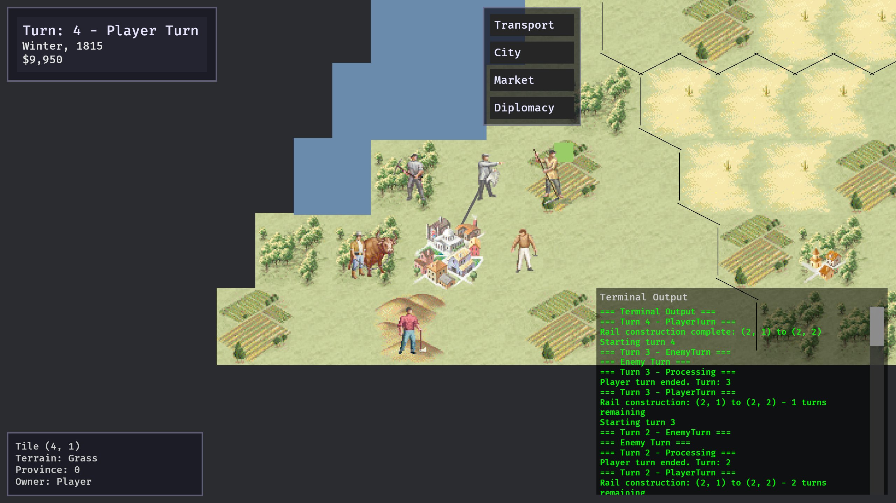

# Rust Imperialism

Una reimplementación moderna del [clásico juego de estrategia de 1997 *Imperialism*](https://www.gog.com/en/game/imperialism), construida con [Bevy](https://bevy.org/) y Rust.

⚠️ **En desarrollo** - Este proyecto está en desarrollo activo y aún no está completo en cuanto a características.



## Acerca del proyecto

Se trata de un juego de estrategia por turnos con enfoque económico, que cuenta con mapas basados en hexágonos, economía y diplomacia multinacionales. El proyecto busca recrear la profunda jugabilidad económica de la versión original mientras moderniza el stack tecnológico.

## Requisitos

**Debes poseer una copia legítima de Imperialism (1997) para poder jugar a este juego.**

Este proyecto requiere archivos de recursos (assets) del juego original. No distribuímos ningún recurso del juego protegido por derechos de autor.

### Prerrequisitos

- Cadena de herramientas de Rust (última versión estable)
- Una copia legítima de Imperialism (1997)
- Los recursos originales del juego extraídos y colocados en `assets/extracted/bitmaps/`

### Extracción de recursos

Antes de ejecutar el juego, necesitas extraer los recursos de mapas de bits (bitmap) de tu copia de Imperialism:

1. Ubica el directorio de instalación de Imperialism
2. Ejecuta el script de extracción (requiere los archivos `.gob` del juego):
   ```bash
   python ./extract_data.py <ruta al directorio de datos de Imperialism>
   ```
3. Esto llenará `assets/extracted` con los recursos necesarios

## Compilación y ejecución

```bash
# Compilar el proyecto
cargo build

# Ejecutar el juego
cargo run

# Ejecutar pruebas
cargo test
```

## Aviso legal

Este es un proyecto no oficial creado por fans. No reclamamos ninguna propiedad sobre Imperialism ni sus recursos. 
Debes poseer el juego original para utilizar este software.
Todos los recursos originales de Imperialism son propiedad de SSI/Frog City Software.
